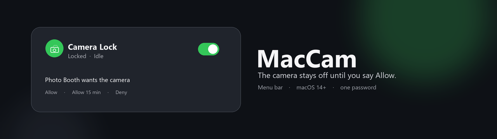

<p align="center">
  
</p>

<p align="center">
  <a href="LICENSE"></a>
  
  
</p>

<p align="center">
  <b>A menu-bar camera lock for your Mac.</b><br>
  Apps cannot open the camera until you tap Allow. Quit the call, and it locks again.
</p>

MacCam sits next to the clock. There is no Dock icon. The first time you turn the lock on, you enter your Mac password once and install a removable profile named **MacCam Disable Camera**. After that, opening Photo Booth, FaceTime, Zoom, or any other camera app shows three choices:

**Allow** · **Allow 15 min** · **Deny**

Allow opens the camera for that session. Deny leaves it closed. Your documents, accounts, and System Integrity Protection are not touched.

## Install in one minute

You need macOS 14 or later and Xcode Command Line Tools (`xcode-select --install`).

```bash
git clone https://github.com/SeifElred/MacCam.git
cd MacCam
chmod +x scripts/*.sh
./scripts/build.sh
open dist/MacCam.app
```

Click the camera icon in the **menu bar**.

1. Turn **Camera Lock** on.
2. Tap **Enable Camera Lock (once)** and enter your Mac password.
3. If System Settings opens, install **MacCam Disable Camera**.

That profile is a camera policy. It is not your user account.

## A normal day

| You want | What you do |
| --- | --- |
| Camera closed while you work | Leave **Camera Lock** on |
| Join a call | Open the app and tap **Allow** |
| A short meeting | Tap **Allow 15 min** |
| Keep it closed | Tap **Deny** |
| Skip the prompt for one app | Add it to the **Allow List** |
| Always block one app | Add it to the **Block List** |
| Come back after a restart | Turn on **Launch at Login** |

When you quit the camera app, MacCam locks again by itself.

## Why people use it

- **The camera is actually unavailable.** Apps stay open and see no camera, the same as if the Mac had none.
- **You stay in control.** Every new camera app asks first. Nothing is force-quit.
- **It gets out of the way.** Menu bar only, Control Center style panel, one accent color.
- **It is honest about the green light.** The LED is wired to camera power. MacCam does not pretend it can flip that wire. See [the LED](#the-green-led).
- **It is easy to undo.** Turn the lock off, or remove the profile in System Settings. [Uninstall](#uninstall) is a few lines.

## What gets installed

| Piece | Where | What it is |
| --- | --- | --- |
| Menu-bar app | Your Mac, no Dock icon | The lock, the Allow prompt, lists |
| Helper | `/Library/LaunchDaemons/com.maccam.cameradisable.plist` | Applies and removes the ban |
| Profile | **System Settings → General → Device Management** | `allowCamera` off, CoreMediaIO access off |

MacCam does not loop-kill Apple’s camera daemon. That wakes the camera and turns the LED back on. It also does not poll the camera while locked, because a status check is enough to power the sensor.

The full story is in [docs/HOW-IT-WORKS.md](docs/HOW-IT-WORKS.md).

## The green LED

The light means the image processor has power. There is no separate off switch.

| What you see | Meaning |
| --- | --- |
| Lock on, the app has no camera, the LED fades after a few seconds | This is the normal path, the same one you get when you quit Photo Booth |
| You tapped Allow and the preview is open | The LED stays on until you quit that app |
| Lock on, nothing is using the camera, the LED is still green after a restart | The processor stayed powered. A slide cover or Apple Support is the remaining fix |

Leave System Integrity Protection on. Commands that `launchctl` Apple’s camera service fail on purpose, and they do not turn the light off.

## Guides

| | |
| --- | --- |
| [Using MacCam](docs/USAGE.md) | First run, Allow / Deny, restore, uninstall |
| [How it works](docs/HOW-IT-WORKS.md) | Profile, helper, LED, files it writes |
| [FAQ](docs/FAQ.md) | Profile error -205, no Dock icon, password prompt |
| [Manual QA](docs/MANUAL_QA.md) | Checklist if you are changing the app |

## Scripts

| Command | Result |
| --- | --- |
| `./scripts/build.sh` | Builds `dist/MacCam.app` |
| `./scripts/test.sh` | Runs the unit tests |
| `./scripts/package.sh` | Zips a build you can hand to someone |
| `./scripts/install-camera-ban.sh` | Opens the profile in System Settings |
| `./scripts/remove-camera-ban.sh` | Opens System Settings so you can remove it |

Current macOS does not allow `profiles install` from Terminal. Install and remove the profile with the mouse in **System Settings → General → Device Management**.

## Uninstall

1. Turn **Camera Lock** off, or remove **MacCam Disable Camera** in Device Management.
2. Choose **Quit MacCam**.
3. Optional:

```bash
sudo launchctl bootout system/com.maccam.cameradisable 2>/dev/null || true
sudo rm -f /Library/LaunchDaemons/com.maccam.cameradisable.plist
sudo rm -rf "/Library/Application Support/MacCam"
rm -rf "$HOME/Library/Application Support/MacCam"
```

Those paths are MacCam’s only files.

## Develop

```bash
open MacCam.xcodeproj
./scripts/test.sh
```

Swift and SwiftUI. The Allow dialog is AppKit so it stays visible and stable as a menu-bar app.

## Requirements

- macOS 14 Sonoma or later
- Apple silicon or Intel
- Xcode Command Line Tools

## License

[MIT](LICENSE). Use it, change it, share it.

If MacCam is useful on your Mac, a star helps the next person find it.
